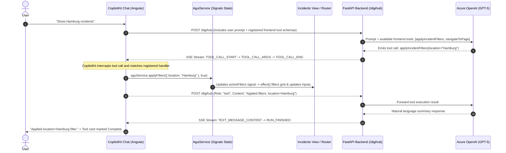

# OpsHub AG-UI Demo (Angular + CopilotKit + FastAPI)

A modern, standalone Angular 22 demo demonstrating **Agentic User Interaction (AG-UI)** for the OpsHub Operational Support portal. It integrates an intelligent AI assistant using **CopilotKit Angular** connected to a **Python FastAPI backend** powered by Azure OpenAI and the AG-UI protocol.

---

## 🌟 Key Features

### 1. Natural Language UI Control (Chatbot Driving the UI)
Users can ask the AI assistant in natural language to perform actions across the UI:
- **Filter Incidents**: E.g., *"Show me open incidents in Hamburg"*, *"Show Cloud Connect incidents in Hamburg from last week"*, *"Retrieve incidents from Frankfurt"*.
- **Automatic Navigation**: The assistant automatically navigates to relevant pages (e.g., *"Take me to billing"*).
- **Incident Details & Knowledge**: E.g., *"Tell me about CCD012098"*, *"How many high-priority incidents are open?"*.

### 2. Bidirectional & Synced Filtering
- **Manual Column Filters**: Users can also filter manually via inline column search inputs (🔍) and status dropdowns (including **"Not Done (Open)"**).
- **Shared Reactive State**: Both manual filters and assistant-applied filters feed into the same reactive signals (`AguiService`), updating filter pills and data grids seamlessly.
- **Visual Feedback**: Dynamic filter pills display active filters, with indicator labels showing whether a filter was applied by the AI assistant.

### 3. OpsHub Design & Styling
- Clean enterprise operational theme:
  - Deep forest-green sidebar (`#2b3e2b`)
  - Icy-blue grid container (`#bbe8ee`)
  - Orange active filter pills (`#ff782d`)
  - Custom responsive layout with CopilotKit sidebar

---

## 🏗️ Architecture

```
┌──────────────────────────────────────────────┐
│        Angular 22 Frontend (Port 4200)       │
│  - Standalone Components                     │
│  - @copilotkit/angular + @ag-ui/client       │
│  - Shared AguiService (Signals State)        │
│  - Frontend Tools (applyIncidentFilters,     │
│    navigateToPage)                           │
└───────────────────────▲──────────────────────┘
                        │ HTTP / SSE (Proxy: /digihub)
┌───────────────────────▼──────────────────────┐
│        Python FastAPI Backend (Port 8888)    │
│  - python_server/server.py                   │
│  - AG-UI Protocol Runner                     │
│  - digihub_agent (Azure OpenAI)              │
│  - Path Rewriting Middleware for CopilotKit  │
└──────────────────────────────────────────────┘
```

---

## 🔄 End-to-End Flow: UI-Based Tool Calls

In this architecture, tools execute directly inside the user's browser (client-side) rather than on the server. This gives the AI assistant direct control over the Angular Router, reactive state signals, and component views.

### Sequence Diagram



### Detailed Step-by-Step Flow

1. **Frontend Tool Registration**:
   - In `chatbot.ts`, client-side actions are declared with `registerFrontendTool()` using Zod parameter validation schemas (`applyIncidentFilters`, `navigateToPage`).
2. **Schema Propagation over AG-UI**:
   - When the user sends a message, `@copilotkit/angular` attaches the client tool schemas into the AG-UI request payload sent to `/digihub`.
3. **Agent Decision**:
   - The Python agent receives the tool definitions alongside its system prompt and current incident knowledge. The LLM selects the appropriate tool and arguments.
4. **SSE Event Streaming**:
   - The backend streams protocol events: `TOOL_CALL_START` $\to$ `TOOL_CALL_ARGS` $\to$ `TOOL_CALL_END`.
5. **Client-Side Execution**:
   - CopilotKit intercepts the event, executes the local handler, updates the shared reactive state via `AguiService`, and returns the completion string as a tool result message.
6. **Final Agent Summary**:
   - The LLM receives confirmation that the tool completed and streams a concise confirmation back to the chat UI.

---

## ⚖️ AI & Manual Flow Coexistence

A core requirement of this architecture is that **manual interactions remain 100% intact and fully synchronized** with AI interactions.

```
                  ┌───────────────────────────────┐
                  │    AguiService (Bridge)       │
                  │   - activeFilters (signal)    │
                  │   - appliedByAssistant (signal│
                  └───────▲───────────────▲───────┘
                          │               │
            Manual Action │               │ AI Tool Call
   (Dropdown / Column 🔍) │               │ (applyIncidentFilters)
                          │               │
        ┌─────────────────┴──────┐ ┌──────┴────────────────┐
        │ Human User Interaction │ │ AI Assistant Action   │
        │ - User types in filter │ │ - User asks in chat   │
        │ - Calls applyFilters() │ │ - Tool calls          │
        │   with byAssistant=false││   applyFilters() with │
        │                        │ │   byAssistant=true    │
        └────────────────────────┘ └───────────────────────┘
```

### How Coexistence is Achieved:
1. **Single Source of Truth (`AguiService`)**:
   - Both manual UI inputs and AI tool handlers read from and write to the same Angular Signals (`activeFilters`, `currentPage`).
2. **Bidirectional Data Binding**:
   - Search inputs on the grid are bound via `[value]="aguiService.activeFilters().location || ''"`.
   - When the AI assistant updates a filter, the table column input reflects the new value immediately.
   - When the user manually changes an input, the same signal is updated with `byAssistant=false`.
3. **Visual Feedback Without Logic Branching**:
   - The `appliedByAssistant` signal toggles indicator labels (e.g., `"Applied by assistant"` pill badge) without diverging the underlying filter logic.

---

## ⚙️ Key Technical Rules & Best Practices

1. **Do NOT Duplicate Tool Definitions in Python**:
   - `applyIncidentFilters` and `navigateToPage` are registered exclusively on the frontend in Angular (`chatbot.ts`).
   - They must **not** be declared as `FunctionTool` in `digihub_agent.py`. Declaring them in both places causes a `Duplicate tool name` error in AG-UI.
2. **Enforce Sequential Tool Execution in Prompts**:
   - To avoid streaming race conditions and duplicate `TOOL_CALL_START` events in the AG-UI protocol, the agent prompt instructs the LLM to call tools sequentially:
     > *"Never call more than one tool at a time. If you need to both navigate AND apply filters, call navigateToPage first, wait for its result, then call applyIncidentFilters in a separate step."*
3. **Loopback Traffic**:
   - Angular dev server proxies `/digihub` and `/agentic_chat` to `http://localhost:8888`. All communication is local loopback traffic.

---

## 🚀 Getting Started

### Prerequisites
- **Node.js**: v20+ (Node v26+ recommended)
- **Python**: 3.12+ (Python 3.13 recommended)
- Azure OpenAI credentials (configured in `.env`)

### 1. Start the Python Backend
In the project root:
```powershell
python -m python_server.server
```
The FastAPI backend will start on `http://localhost:8888`.

### 2. Start the Angular Dev Server
In a separate terminal:
```powershell
cmd /c "npm start"
```
The Angular application will start on `http://localhost:4200` with proxy configuration forwarding `/digihub` and `/agentic_chat` to the backend.

---

## 💬 Sample Demo Queries

Try these in the CopilotKit chat sidebar:

| Query | What Happens |
| :--- | :--- |
| **"Show me open incidents in Hamburg"** | Navigates to incidents grid, filters by `Status: Open` and `Location: Hamburg` (shows 6 tickets). |
| **"Show Cloud Connect incidents in Hamburg from last week"** | Applies multi-parameter filter (Service + Location + Time Window). |
| **"Retrieve incidents from Frankfurt"** | Displays all Frankfurt incidents without enforcing an "Open" status filter (shows 2 tickets). |
| **"Tell me about CCD012098"** | Assistant reads details from data and replies directly with ticket status and details. |
| **"Take me to billing"** | Assistant triggers `navigateToPage` and opens the Billing view. |
| **"Navigate to operational support and search incidents with location starting with H"** | Sequentially calls `navigateToPage`, then calls `applyIncidentFilters(location="Hamburg")`. |

---

## 📁 Project Structure

```
digihub-agui-demo/
├── python_server/
│   ├── __init__.py
│   ├── server.py              # FastAPI server + CORS + AG-UI endpoint
│   └── digihub_agent.py       # Incident agent with context & tool instructions
├── src/
│   ├── app/
│   │   ├── components/
│   │   │   ├── chatbot/       # CopilotSidebar + frontend tool registrations
│   │   │   ├── main-layout/   # Topbar + Left Sidebar + Chatbot layout
│   │   │   ├── sidebar/       # Portal Navigation sidebar
│   │   │   └── topbar/        # Customer header
│   │   ├── pages/
│   │   │   ├── billing/       # Billing page
│   │   │   ├── incidents/     # Incidents table with column search & filter pills
│   │   │   └── operational-support/
│   │   ├── services/
│   │   │   ├── agui.service.ts # Central reactive signals state
│   │   │   └── mock-data.ts    # Incident dataset & filtering logic
│   │   ├── app.config.ts      # CopilotKit provider configuration
│   │   └── app.routes.ts      # Angular routing
│   └── styles.scss            # Global styles and CopilotKit chat overrides
├── proxy.conf.json            # Dev server proxy to port 8888
└── angular.json
```
